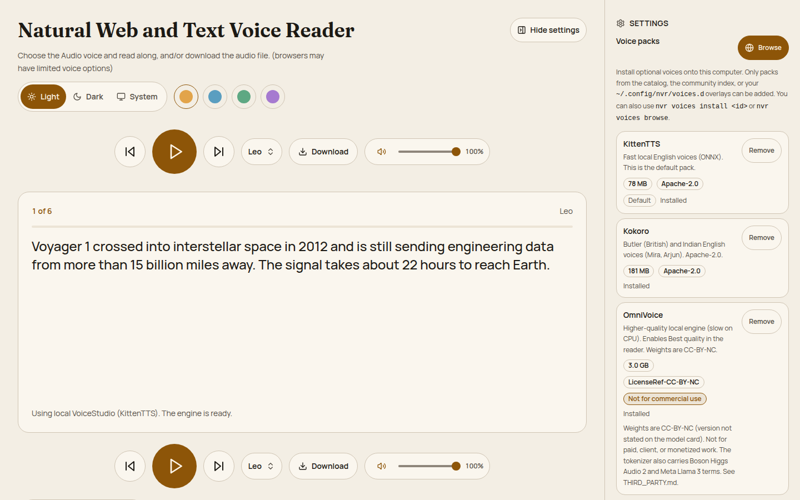
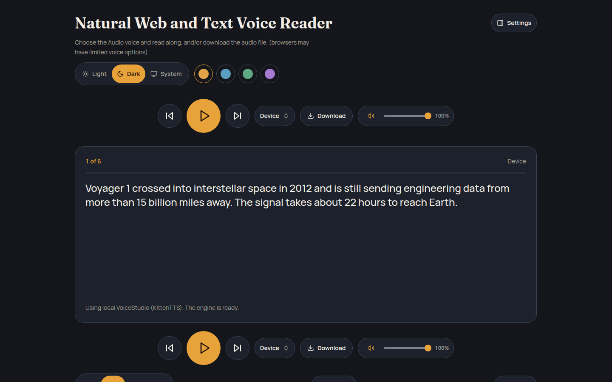
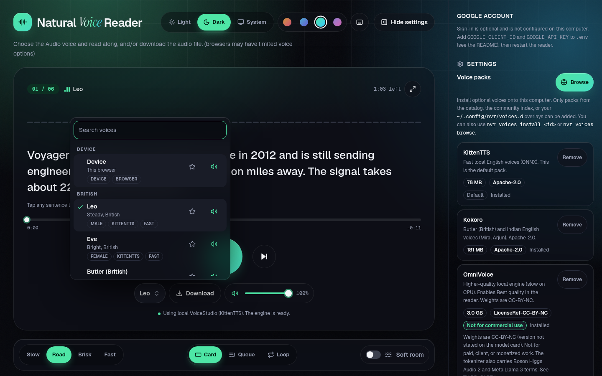
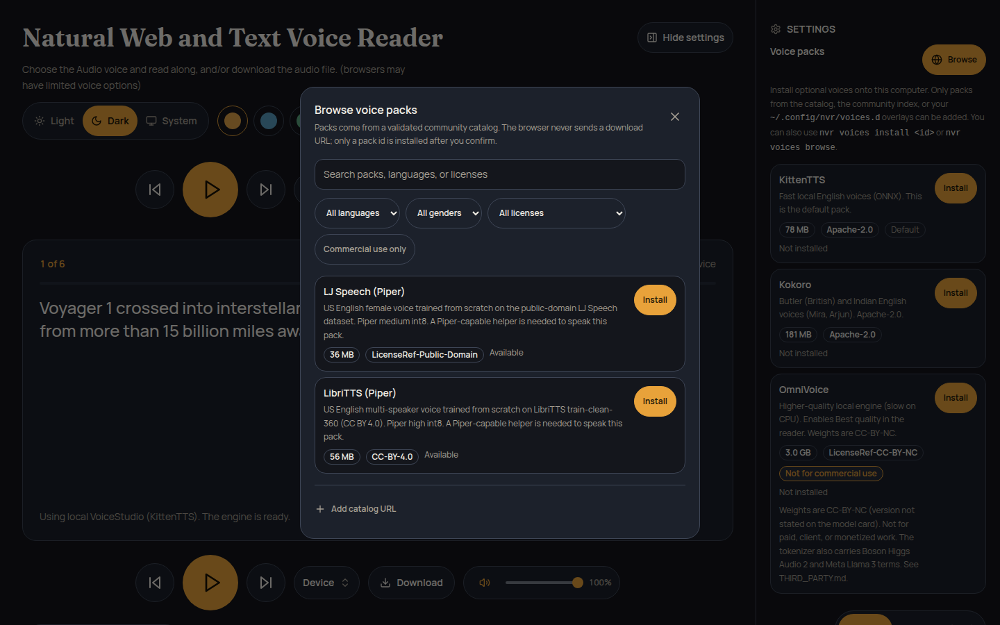
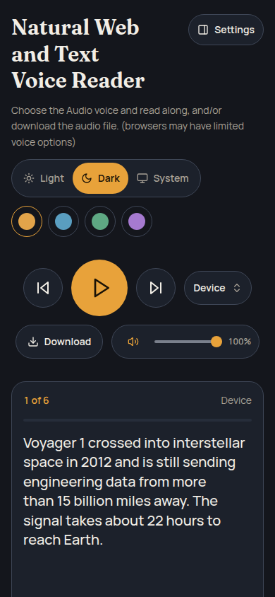

# Natural Voice Reader

Natural Voice Reader turns pasted text and public web pages into a listenable
reading queue. Choose a voice and playback speed, move between reading cards,
and download generated audio. Your queue and preferences are stored in this
browser.

## Screenshots

Dark and light themes, settings hidden so the queue can use the full width,
the searchable voice picker, the community pack browser, and a phone-sized
layout. Appearance can follow the system theme, and four accents (Amber, Sky,
Sage, and Violet) tint the controls in both modes.












## Requirements

- Node.js 22 or newer
- npm
- Optional: a local VoiceStudio API on `http://127.0.0.1:3900` (preferred for
  generated voices) and a local Kokoro helper on `http://127.0.0.1:3901` for
  Butler and the Indian English voices
- Optional: an `XAI_API_KEY` in the server environment as a cloud fallback.
  Without VoiceStudio or that key, the app uses this browser's device voice.

## Install (Linux, macOS, Windows)

The script-based bootstrap checks for Node.js 22+, uv, Python 3.11, the
reader's npm dependencies, and a pinned VoiceStudio checkout. Missing pieces
are installed. KittenTTS weights download on demand from Hugging Face into
the per-user data directory, with progress shown in the reader UI. That is the only
pack the installer adds by default. Optional packs such as Kokoro (Butler and
Indian English) and OmniVoice are installed later from **Settings > Voice packs**
or with `nvr voices install <id>`. OmniVoice weights are larger and CC-BY-NC
(not for commercial use); `--with-omnivoice` still fetches that pack at install
time if you want it immediately.

Linux and macOS:

```sh
./scripts/install.sh
```

`./scripts/install.sh --dry-run` prints what would happen and changes nothing.
The macOS path uses the same script; it has not been run on a Mac in this
work.

Windows (PowerShell, **untested**):

```powershell
powershell -ExecutionPolicy Bypass -File scripts\install.ps1
```

VoiceStudio is AGPL-3.0 and is fetched as a separate, pinned repository. It
is not vendored into this project. See `THIRD_PARTY.md` for model licenses
and AGPL notes. A packaged desktop app (Tauri, later) is a future option;
the installer today is the script bootstrap.

## Run locally

The usual way is one command, which stops leftover VoiceStudio, Kokoro, or
reader listeners on ports 3900, 3901, and 8080, starts VoiceStudio and the
Kokoro helper, waits for health, downloads a missing voice model if needed,
warms the engines, starts the reader, and opens the browser. Press Ctrl+C to
stop them.

```sh
nvr
```

That command is a symlink to `scripts/nvr.sh`. If `nvr` is not on your PATH
yet, run:

```sh
~/Dev/Source/Natural-Voice-Reader/scripts/nvr.sh
```

On Windows use `scripts\nvr.cmd` (**untested**).

Or, after `npm ci`, start only the reader (VoiceStudio must already be running):

```sh
npm run dev
```

Open `http://localhost:8080`. The app's checked-in workspace config keeps
authentication disabled for local development. Never expose secrets through a
`VITE_`-prefixed variable. `scripts/with-app-env.mjs` only loads `VITE_` flags
from `.grok/app-env.json`; it does not load API keys.

## Command-line speech

`nvr say` (also installed as `nvr-say`) turns text into an MP3 using the same
local VoiceStudio and Kokoro voices as the reader. It starts only the engine
the chosen voice needs, writes the file, and stops anything it started. It
does not open the browser, and it does not stop engines that were already
running. The default voice is Leo on KittenTTS.

```sh
nvr say --text "Hello, Gary." --out ~/Music/hello.mp3
nvr say --voice butler --text "Good evening." --out ~/Music/butler.mp3
nvr-say --list-voices
```

You can also pass the text as arguments, or pipe it on stdin:

```sh
nvr say --out ~/Music/hello.mp3 Hello, Gary.
echo "Dinner is ready." | nvr say --out /tmp/nvr-say.mp3
```

`--out -` writes raw MP3 bytes to stdout. Use `--keep` if you are making
several clips and want VoiceStudio or Kokoro to stay up. Use `--model omnivoice`
for the slower high-quality engine on the standard voices. Butler, Mira, and
Arjun always use Kokoro, so the accent is not replaced.

### Play the clip on a speaker or clock

`clockctl` can play the file on a Cast device such as a Lenovo Smart Clock.
The usual pattern is to write the MP3, then play it:

```sh
nvr say --text "Good morning, Gary." --out ~/Music/wake.mp3 && clockctl play ~/Music/wake.mp3
echo "Dinner is ready." | nvr say --out /tmp/nvr-say.mp3 && clockctl play /tmp/nvr-say.mp3
```

`clockctl play` needs a file path or an http(s) URL, so pipe the audio bytes
into it only if you first write a file as shown above.

### Wake-ups and conversations from a bot

A bot on a laptop or phone can use this the same way a person would: produce
text, ask `nvr say` to speak it, then cast the file.

For a wake-up, a scheduled cron job or a routine can write a short morning
line and play it on the clock at a set time:

```sh
nvr say --text "Good morning. It is 6:30, and the coffee is the next thing." \
  --out ~/Music/wake.mp3 && clockctl play ~/Music/wake.mp3
```

Keep those clips short, and set the clock volume ahead of time so the morning
message is not a surprise blast.

For a spoken conversation, the loop is speech-to-text, an LLM reply, this CLI,
then play or cast:

- Capture a short utterance from a microphone and transcribe it with a local
  or device speech-to-text tool.
- Send that text to a language model and take the reply.
- Run `nvr say --text "$REPLY" --out /tmp/nvr-reply.mp3`.
- Play the reply with `clockctl play /tmp/nvr-reply.mp3`, or on the local
  speaker if you are not using a Cast device.
- Wait until playback finishes, then listen for the next utterance.

The voice work stays on the local engines, so the bot does not need a cloud
TTS key. You will still need your own speech-to-text and language-model setup
for the other two steps. This CLI only does the "speak this text" part.

## Local voices (VoiceStudio)

The reader prefers a local VoiceStudio server and speaks sentence by sentence
so playback can start before a whole card is ready. Butler (British) and the
Indian English voices (Mira, Arjun) use a small Kokoro helper on port 3901.
If VoiceStudio is down, the original KittenTTS/OmniVoice voices fall back to
xAI when `XAI_API_KEY` is set, then to this browser's device voice. Butler and
the Indian English voices do not fall back, so the accent is not silently
replaced.

`nvr` pins one exact VoiceStudio engine (`kittentts` by default, or
`omnivoice` if you set `NVR_TTS_MODEL=omnivoice`) and warms it, and also
starts Kokoro. Choose **Fast local** (KittenTTS) or **Best quality (slow)**
(OmniVoice) in the app to switch the standard voices. The first load can take
a minute; the reader shows "Loading voice engine" or a download percent
instead of treating that wait as a failure. Never use `voxcpm2`. OmniVoice
weights are CC-BY-NC (personal use only). A **Soft room** toggle adds a light
playback-only room tone; downloads stay dry.


## Voice packs

The reader ships a catalog in `voices/catalog.json`. Each pack declares its
engine, voices (with language, accent, and gender tags), download source,
pinned revision, file checksums where feasible, size, SPDX license, and
whether it may be used commercially. The current packs are:

- **kittentts** — default, Apache-2.0, the standard English voices
- **kokoro** — optional, Apache-2.0, Butler (British), Mira, and Arjun
- **omnivoice** — optional, CC-BY-NC, enables **Best quality (slow)**

Installed voices appear in the searchable voice picker, grouped by accent or
language, with gender, engine, and quality badges. Favorites and recent voices
stay at the top. A compact version of the picker lives in the playback bar so
you can change the voice while Settings is hidden.

The settings panel can be hidden to give the queue the full width. Use the
Settings button, or press `,` (or Ctrl+, / Cmd+,). Choose Light, Dark, or
System (the default for new readers, following the device theme), and pick an
accent for buttons and highlights. On screens narrower than
1024px the panel starts collapsed and opens as a slide-over drawer. That
preference is saved with the rest of the reader settings.

Next to the speed buttons, choose what happens when a card ends. **Card** (the
default) stops and cues the next card, so Play continues where you left off.
**Queue** plays every card and stops after the last. **Loop** starts again
from the first card. The Next button always moves ahead; only Loop wraps from
the last card to the first.

`Clear queue` removes every card, after a confirmation, and offers Undo.
`Reset to defaults` restores the voice, speed, volume, engine, and settings
panel without touching the queue or installed packs.

```sh
nvr voices list
nvr voices install kokoro
nvr voices remove kokoro
nvr voices browse
nvr voices browse ljspeech
```

Downloads go into the per-user data directory, are verified when checksums are
in the catalog, and can be removed to free disk space:

- Linux: `$XDG_DATA_HOME/nvr` (default `~/.local/share/nvr`)
- macOS: `~/Library/Application Support/nvr`
- Windows: `%LOCALAPPDATA%\nvr`

Sherpa packs (Kokoro) land in `sherpa/` under that directory. Hugging Face
packs (KittenTTS, OmniVoice) use a private `huggingface/` tree there; `nvr`
sets `HF_HOME` only for VoiceStudio, the Kokoro helper, and other processes it
starts, so other apps keep their own Hugging Face cache. A one-time migration
moves any existing files out of `~/.cache/nvr` and our pack folders under
`~/.cache/huggingface` (it does not copy, and it leaves unrelated Hugging Face
repos alone). You can point everything at a custom root with `NVR_DATA_HOME`.
Overlay catalogs stay in the config directory (`~/.config/nvr/voices.d` on
Linux). The UI and the CLI only accept pack ids from the official catalog, a
validated community index, or your overlays. They will not fetch an arbitrary
URL from the client.

### Community packs

**Settings > Voice packs > Browse** loads a remote community index (the same
schema as `voices/catalog.json`). The default index is
`voices/community-catalog.json` in this repository
(`raw.githubusercontent.com/garyleebairdjr-cmyk/Natural-Voice-Reader/main/voices/community-catalog.json`).
The server fetches that JSON, checks the schema, allows only https hosts such
as `github.com` and `huggingface.co`, caps the index size, and requires a
sha256 digest on every community pack file. Installing writes an overlay under
`~/.config/nvr/voices.d/` marked `community` and then uses the normal install
path.

The shipped community index currently includes two English Piper packs whose
MODEL_CARDs are clearly licensed and were trained from scratch: LJ Speech
(public domain) and LibriTTS (CC BY 4.0). Voices fine-tuned from Lessac,
marked non-commercial, or with unclear cards (including `en_GB-alan`) are not
listed. A Piper-capable helper is still needed to *speak* those packs after
they are installed.

Advanced users can add another catalog URL in Settings, with a warning that
the source must be trusted. `NVR_COMMUNITY_INDEX` can point at a local file
and `NVR_CATALOG_ALLOW_LOCAL=1` allows `file://` or localhost indexes for
testing.

### Adding your own packs

Place a JSON file next to the official schema in `~/.config/nvr/voices.d/`
(on Windows, `%APPDATA%\nvr\voices.d\`). See `voices/overlay.example.json`.
Overlay files use the same catalog schema. New pack ids are merged in;
overlay ids cannot replace an official pack. Supported source kinds today are
`huggingface` and `tarball` (https only). Engines listed in the catalog can
include `piper` and other extensions; speaking a custom engine still needs a
compatible local helper.


## Google sign-in (optional)

The reader works fully without an account. If you set a Google client ID, a
**Sign in with Google** button appears in Settings. After you sign in, the app
creates a `Natural Voice Reader` folder in your Google Drive (with `Settings`
and `Downloads` subfolders) and can:

- Sync appearance, voice, speed, volume, favorites, recents, and panel state to
  `Settings/settings.json` (no tokens or other secrets).
- Open a Google Doc, `.txt`, or Markdown file with the Google Picker and add it
  to the queue.
- Optionally upload downloaded audio to `Downloads` when you turn on **Save
  downloads to Google Drive** (off by default). A local file is still saved.

Sign-out revokes the access token and clears Google state on this device.

Earlier versions named this folder `Natural Text Reader`. The next time you
sign in, the app renames that folder in place, so your settings and downloads
stay where they are. A folder you renamed yourself is left alone.

### Set up a Google Cloud client (personal account)

Use a project on your own Google account. Do not reuse a work or client
project. You can create a new project or use an existing personal one.

1. Open [Google Cloud Console](https://console.cloud.google.com/) and create or
   select a project.
2. Enable the **Google Drive API** and the **Google Picker API**.
3. Configure the OAuth consent screen: User type **External**, publishing status
   **Testing**, and add your Google account as a test user. The app only requests
   `openid`, `email`, `profile`, and `https://www.googleapis.com/auth/drive.file`
   (non-sensitive; verification is not required for testing).
4. Create an OAuth **Web application** client ID. Under Authorized JavaScript
   origins add `http://127.0.0.1:8080` and `http://localhost:8080`. You can leave
   redirect URIs empty for this token-based sign-in.
5. Create a Browser API key for the Picker. Restrict it to those same HTTP
   referrers, and restrict the key to the Drive API and Picker API if asked.
6. Copy `.env.example` to `.env` (never commit `.env`) and set:

```
GOOGLE_CLIENT_ID=your-client-id.apps.googleusercontent.com
GOOGLE_API_KEY=your-browser-api-key
```

7. Restart the reader (`nvr`). The Sign in button should appear in Settings.

### Privacy

Google sign-in is optional. Tokens are kept only in memory or session storage
and are revoked on sign-out; they are never written to the repo or to logs.
The `drive.file` scope lets the app use files it creates or that you pick in
the Picker; it cannot see the rest of your Drive. Settings uploaded to Drive
are the same kinds of preferences already stored in this browser (theme, voice,
speed, volume, favorites, recents, and panel state), not passwords or API keys.
Downloads are uploaded only if you turn that option on.

## Roadmap

The speech pipeline is already typed so later STT, translation, and smaller
on-device models can slot in without rewriting the queue UI. A German-accented
English voice is not shipped today: a style-prompted English model sounded
American. That should wait for a native-German speaker model, not an overlay
or caricature. Japanese English was also dropped from the picker after the
available speakers sounded unnaturally high-pitched.

## Useful commands

```sh
npm run typecheck
npm test
npm run lint
npm run build
nvr say --text "Hello." --out /tmp/nvr-hello.mp3
```

## Notes

- Text cards, playback preferences, and the reading queue are persisted in
  browser storage. If you sign in with Google, those preferences (not the
  queue, and not any tokens) can also sync to the Natural Voice Reader folder
  in your Drive.
- Reading a URL fetches its public page on the server. Some pages may block
  fetching or require a browser to render their content.

## License

MIT, see [LICENSE](LICENSE). Third-party engines and voice models keep their own licenses, listed in [THIRD_PARTY.md](THIRD_PARTY.md). VoiceStudio (AGPL-3.0) is a separate download and is not included here, and the OmniVoice weights are non-commercial only.
